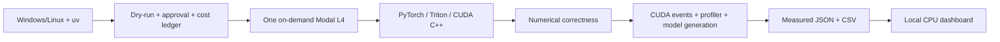

# Helix GPU Kernels

An experimental GPU engineering laboratory for transformer inference: original
CUDA C++ and Triton kernels, realistic PyTorch baselines, numerical derivations,
bounded Modal experiments, and a local results dashboard.

The goal is to explain performance through execution mapping, numerical choices
and measurements. Custom kernels are experiments, not assumed improvements over
cuBLAS, native PyTorch, or SDPA. Slower implementations remain in the reports.

## Implementations

| Operation | CUDA C++ | Triton | Native baseline |
|---|---|---|---|
| Stable softmax | Warp/block reductions, three coalesced input passes | Fused power-of-two row reduction | `torch.softmax` |
| GEMM | Naive and 16×16 shared-memory tiles, FP32 FMA | 32×32×32 tiles, FP32 accumulation | `torch.matmul` / cuBLAS |
| Exact tiled attention | 16-key tiles, one query per block, online normalization | Query/key tiles, online normalization | PyTorch SDPA; materialized math reference |
| RMSNorm | Fused sum-of-squares, normalization and scale | Fused row reduction and scale | Native `F.rms_norm`; composed reference |
| INT8 weight-only linear | Shared tiles, fused scale, floating-point accumulation | Fused dequantization and dot | Dequantize + matmul; original floating weights |

All custom kernels are forward-only, accept contiguous CUDA tensors, and support
FP32/FP16/BF16 storage with FP32 accumulation. CUDA GEMMs use SIMT instructions;
they do not implement Tensor Core MMA. Triton low precision GEMM can use Tensor
Cores through `tl.dot`. INT8 weight compression does not imply INT8 arithmetic or
inference acceleration. INT4 is intentionally deferred.

## Status and evidence

GPU results, validation outcomes, profiling observations and inference measurements
are recorded in [the experiment report](benchmarks/reports/initial-l4.md).
Never interpret skipped GPU tests as a passing GPU validation run. Supported GPU
claims apply only to devices named in measured artifacts. A10 and H100 experiments
require separate approval and have not been implied by an L4 experiment.

The initial NVIDIA L4 run passed **176 correctness tests** and **171 benchmark
comparisons**. Representative FP16 CUDA Graph medians (µs per captured operator):

| Operation / shape | PyTorch | Triton | CUDA |
|---|---:|---:|---:|
| Softmax 128×1024 | 4.813 | 2.304 | 3.686 |
| RMSNorm 128×1024 | 15.565 | 2.099 | 3.277 |
| GEMM M128 K768 N3072 | 11.162 | 21.709 | 259.072 tiled |
| Causal attention B1 H4 N256 D64 | 9.216 | 11.366 | 121.648 |

These exclude Python scheduling and output allocation; dispatch timings can give
a different comparison, as the [full report](benchmarks/reports/initial-l4.md)
shows. Pretrained SmolLM2 inference with Triton RMSNorm observed 730.8→666.8 ms
median generation time (1.096×) over three repetitions, with identical generated
tokens. That small fixed-order trial is preliminary, with overlapping latency
tails. INT8 storage compressed weights but did not beat original FP16 linear in
the representative graph comparison. Conservative cumulative cost reservations
were $1.316502; actual provider billing remains to be reconciled.

## Requirements and setup

- Python 3.12 and [uv](https://docs.astral.sh/uv/).
- Windows or Linux for local development and CPU tests. Local CUDA is optional.
- Authenticated [Modal](https://modal.com/docs/guide) workspace for GPU jobs.
- NVIDIA SM80+ target for the current BF16/Triton configuration. Actual GPU,
  driver, CUDA runtime/toolkit, device memory and software versions are recorded.
- CUDA compilation uses `nvidia/cuda:12.6.3-devel-ubuntu22.04`, a C++17 compiler,
  PyTorch 2.7.1 CUDA 12.6 wheels, and Triton 3.3.1. Local uv uses CPU wheels.

Preserve your existing environment:

```powershell
uv sync --frozen --group dev
uv run pytest -m "not gpu" -q
uv run ruff check .
uv run ruff format --check .
uv run python scripts/check_repository.py
uv build
```

On Windows, set `$env:PYTHONUTF8='1'` before Modal CLI commands if the terminal's
default encoding cannot display Unicode. Do not repeat `modal setup` when already
authenticated. Tests and imports do not compile CUDA on CPU-only machines.

## Architecture



See [design and implementation tradeoffs](docs/architecture/design.md),
[CUDA execution mappings](cuda/README.md), [mathematical foundations](docs/mathematics/numerics.md),
and [inference validation](docs/mathematics/inference.md).

## Reproduce GPU experiments

These commands default to **dry-run** and do not invoke remote functions:

```powershell
uv run helix plan
uv run modal run modal_apps/gpu_info.py
uv run modal run modal_apps/test_kernels.py
uv run modal run modal_apps/benchmark.py
```

After explicit approval of the displayed L4 plan, execute sequentially:

```powershell
uv run modal run modal_apps/gpu_info.py --execute --approved-usd 1
uv run modal run modal_apps/test_kernels.py --execute --approved-usd 1
uv run modal run modal_apps/benchmark.py --execute --approved-usd 1 --inference
uv run helix cost-report
```

`--approved-usd` is the cumulative local authorization ceiling, not a new allowance
for every command. Existing reservations count against it. A fresh approved batch
needs a suitable explicit cumulative ceiling; each individual run is additionally
limited to a conservative $1 estimate. Do not clear failed reservations to obtain
more scheduling capacity. The local $30 project limit is not a provider spending
cap and does not include unrelated account activity. Current prices and assumptions
are in [benchmark methodology and costs](docs/performance/methodology.md).

The full larger-shape suite uses `--config transformer` instead of the smoke
configuration; it requires approval of its own plan. All jobs have explicit
timeouts, zero retries, at most one container and a two-second idle tail. No
persistent deployment, volume, cron, or always-on GPU dashboard is created.

Artifacts are returned to `benchmarks/results/` as JSON and CSV. Hardware versions,
configuration, samples, numerical errors, status and cost reservation accompany
results. Raw artifacts are normally ignored by Git; reviewed measurements can be
added explicitly. The dashboard never substitutes synthetic data for missing runs.

## Kernel usage

```python
import torch
from triton_kernels.softmax import softmax
from helix.runtime.cuda import gemm

with torch.inference_mode():
    x = torch.randn(128, 1024, device="cuda", dtype=torch.float16)
    probabilities = softmax(x)
    a = torch.randn(128, 768, device="cuda", dtype=torch.float16)
    b = torch.randn(768, 3072, device="cuda", dtype=torch.float16)
    c = gemm(a, b, variant="tiled")
```

CUDA sources compile lazily on the first custom CUDA call in the development
container. There is no hidden fallback to another backend. Output allocation is
part of each wrapper; the measurements describe GPU event intervals around
operator dispatch, not isolated preallocated kernel replay or full model inference.

## Mathematical and experimental scope

Softmax subtracts a row maximum before exponentiation. Attention maintains a
running maximum, normalization sum and weighted numerator across tiles; it never
materializes the quadratic score matrix. In exact arithmetic this is equivalent
to dense attention, while floating-point reduction order introduces error.
Causal and noncausal modes, ragged sizes and multiple head dimensions are tested.
There is no backward pass, dropout, GQA, arbitrary attention mask, or custom KV cache.

GEMM uses 2MNK theoretical FLOPs. The performance model distinguishes useful
arithmetic, minimum analytical I/O, actual allocated memory and measurable hardware
counters. Register/shared-memory compiler diagnostics are not occupancy measurements.
We preserve profiler permission failures rather than manufacturing counter values.
See [benchmark methodology](docs/performance/methodology.md) for timing, precision,
memory, caching, warmup, variability and roofline interpretation.

## Real inference

The demonstrator loads Apache-2.0 licensed `HuggingFaceTB/SmolLM2-135M` at an
immutable revision and replaces its RMSNorm modules while preserving model weights,
epsilon, attention and generation settings. It measures synchronized greedy
generation on a real prompt, tokens/s, allocator peaks, logits error and token
agreement. Downloads and model initialization are excluded from inference timings.
Microbenchmark improvements are not extrapolated into model speedups.

Use the benchmark command's `--inference` option to include this experiment.
Local optional dependencies are available through `uv sync --extra inference`.

## Dashboard

```powershell
uv run --extra dashboard python -m streamlit run dashboard/app.py
```

Filter measured artifacts by kernel, GPU, shape, precision, causal mask and run.
Inspect latency samples, speedups, useful throughput, analytical I/O bandwidth,
numerical error, allocator memory and reserved cost. A separate, prominently
labeled **synthetic UI demonstration** is available when there are no experiments.
The dashboard runs on the CPU and needs no cloud deployment.

## Quality and next research steps

GitHub Actions runs CPU correctness, Python lint/format, CUDA source formatting,
documentation/config checks and distribution builds on Windows and Linux. GPU
correctness is an explicit Modal job, never an automatically billed PR check.

Future research: vectorized CUDA row loads, register-blocked GEMM, explicit MMA,
architecture-aware tiles, bounded measured tuning, cooperative query attention,
longer-sequence coverage, robust benchmark ordering and locked-clock experiments.
The current code exposes the optimization choices and their limits rather than
claiming parity with vendor libraries or the production FlashAttention library.

Foundational work and official documentation are collected in
[references and attribution](docs/research/references.md). Third-party dependencies
and model weights retain their licenses; model weights are not committed here.
