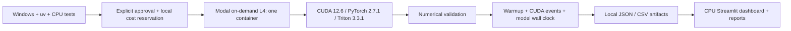

# Architecture and reproducibility

Local PyTorch wheels come from the official CPU index; the Modal image installs
the matching PyTorch release from the CUDA 12.6 index. Triton 3.3.1 is the GPU
wheel's dependency. Runtime metadata records the actual interpreter, wheel,
driver, toolkit, device and precision settings. Python 3.12 patch releases and
transitive container dependencies may differ from the local uv lock: the image
recipe pins direct GPU dependencies, while the artifact records observed versions.
For archival bit-for-bit replay, retain the Modal image identity and package manifest.

CUDA is compiled lazily in a development container, never at Windows import time.
The extension follows the current CUDA stream under a device guard. Operators
are forward-only and reject autograd inputs while gradient recording is active.
The repository and wheel contain CUDA sources. Remote jobs upload only named
source directories and configuration files; credentials and the local environment
are never uploaded.

The current custom CUDA GEMMs use SIMT FP32 accumulation. The Triton FP16/BF16
GEMM can lower dot products to Tensor Cores; FP32 dot uses IEEE precision, with
TF32 disabled. Instruction-level verification requires disassembly/profiling;
we do not infer utilization from a kernel name. Attention retains FP32 probabilities
for the PV product, prioritizing numerical validation over throughput.

No job is deployed permanently. There are no schedules or persistent volumes.
Every GPU entrypoint defaults to dry-run. A local ledger prevents overlapping
dispatches from this checkout, but is not a distributed lock across clones.
Modal's function limit is per app, so the local lock is necessary. An interrupted
reservation must be reconciled with Modal app state before a human clears it.

## Deliberate limitations

Fixed tiles avoid unbounded tuning costs. No automatic architecture-specific MMA,
async copies, warp specialization or register blocking are implemented. CUDA
attention stages 16 keys per query block and repeats K/V reads across queries;
its scratch is bounded, but it is expected to lose to SDPA in many cases. CUDA
softmax rereads rows three times to bound register usage. Triton retains a
power-of-two row in registers, bounded to width 65,536. Their wide-row tradeoffs
are distinct and must be measured. Vectorized CUDA loads remain future work.

INT8 uses contiguous signed bytes and one FP32 scale per output channel, with no
zero point. There is no nibble packing or INT4 extension. Fused kernels avoid a
full dequantized weight allocation, but arithmetic remains floating point.

Supported target baseline: NVIDIA Ampere or newer (SM80+) for BF16 and the pinned
Triton toolchain. Measured GPU support is restricted to hardware named in real
artifacts; H100/A10 compatibility is not established by static source review.
